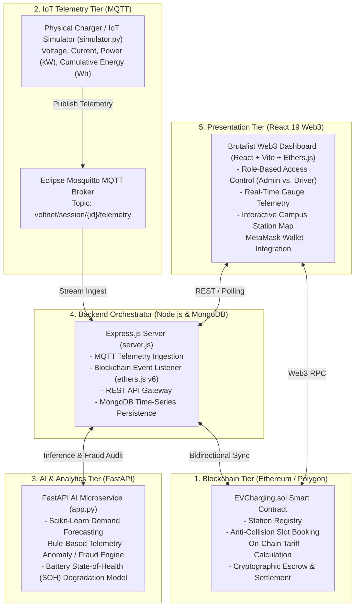

# VoltNet: Decentralized, AI-Driven Smart EV Charging Infrastructure

[](https://soliditylang.org/)
[](https://polygon.technology/)
[](https://react.dev/)
[](https://nodejs.org/)
[](https://fastapi.tiangolo.com/)
[](https://mosquitto.org/)
[](https://www.mongodb.com/)

---

## ⚡ What is VoltNet?

**VoltNet** is an end-to-end, decentralized Electric Vehicle (EV) charging and microgrid energy management platform. It integrates **blockchain smart contracts**, **real-time IoT telemetry**, **machine learning microservices**, and an **industrial Web3 dashboard** to solve major bottlenecks in modern EV charging networks:

1. **Centralized Failures & Billing Discrepancies**: Replaces opaque charging billing and operator lock-in with trustless Ethereum smart contracts that compute payments strictly from cryptographically verified IoT meter readings.
2. **Grid Overloading & Peak Congestion**: Uses dynamic grid pricing, machine learning demand forecasting, and renewable energy incentives to shift charging demand to off-peak hours and high solar-yield periods.
3. **Meter Tampering & Telemetry Fraud**: Audits physical charging sensor streams (voltage, current, power, cumulative energy) in real-time to flag spoofed data, grid surges, and power bypass.
4. **Slot Collisions**: Eliminates double-booking with on-chain booking validation directly in the smart contract state machine.

---

## 🏗️ 5-Tier System Architecture

VoltNet operates across five synchronized architectural tiers:



---

## 🚀 Key Modules & Capabilities

### 1. Smart Contracts (`hardhat/contracts/EVCharging.sol`)
* **State Machine**: Tracks session lifecycles: `Booked` ➔ `Charging` ➔ `Completed` ➔ `Paid` (or `Cancelled`).
* **Non-Overlapping Booking Engine**: Prevents double-booking by mathematically verifying time window overlap (`startTime` to `endTime`) for each station.
* **Trustless Settlement Formula**:
  $$\text{Total Bill (Wei)} = \text{EnergyConsumed (Wh)} \times \text{BasePrice} \times \left(1 + \frac{\text{DemandLevel}}{100} - \frac{\text{RenewableRatio}}{200}\right)$$
  Ensures a guaranteed floor price ($P \ge 0.5 \times P_{\text{base}}$) to prevent economic exploitation while incentivizing green power.
* **Direct P2P Escrow**: Payments flow securely from the EV driver's wallet directly to the station operator's address upon session completion.

### 2. IoT Telemetry & MQTT Messaging (`iot/`, `mosquitto/`)
* **Live Telemetry Stream**: Continuous sampling of real-world electrical metrics:
  * Operating Voltage ($228\text{V} - 232\text{V}$)
  * Current draw (Level 2 charging, ~32A)
  * Real-time Power ($P = V \times I$ in Watts/kW)
  * Cumulative Energy ($\Delta Wh = \frac{P \times \Delta t}{3600}$)
* **Eclipse Mosquitto Broker**: Dockerized high-throughput pub/sub broker handling telemetry channels under `voltnet/session/{sessionId}/telemetry`.

### 3. AI Predictive Analytics & Fraud Detection (`ai/app.py`)
* **Demand Forecasting (`/predict-demand`)**: Scikit-Learn Linear Regression trained on historical campus charging patterns to forecast station occupancy based on station ID, time of day, and day of week. Dynamically activates peak pricing markups (+30%) or off-peak green discounts (-50%).
* **Real-Time Telemetry Fraud Detection (`/detect-fraud`)**: Audits incoming electrical streams against four physical violation rules:
  1. *Zero-time energy anomaly*: Significant energy recorded with zero elapsed duration.
  2. *Physical over-current limit*: Reported power exceeding charger hardware limit (>25 kW).
  3. *Non-monotonic energy tampering*: Cumulative energy dropping between consecutive readings.
  4. *Voltage grid instability*: Voltage dipping below 160V or spiking above 280V.
* **Battery State-of-Health (SOH) Estimator (`/battery-health`)**: Evaluates battery degradation and remaining useful life based on charging speed and cycle history.

### 4. Middleware & Data Persistence (`backend/`)
* **MQTT Ingestion Worker**: Ingests incoming sensor packets, persists real-time telemetry time-series into MongoDB, and updates live session statuses.
* **Blockchain Event Synchronizer**: Uses Ethers.js v6 to listen for on-chain events (`SlotBooked`, `ChargingStarted`, `ChargingEnded`, `BillPaid`) and reconciles them with MongoDB in real time.
* **REST API Gateway**: Exposes clean endpoints for stations, sessions, pricing adjustments, and AI telemetry audits.

### 5. Brutalist Web3 User Interface (`frontend/`)
* **Industrial Brutalist Aesthetic**: High-contrast, functional design optimized for physical infrastructure monitoring with zero unnecessary blur or glassmorphism.
* **Role-Based Access Control (RBAC)**:
  * **EV Driver**: Browse stations on campus, view live tariffs and solar shares, reserve slots via MetaMask, view real-time charging meters, and settle bills with crypto.
  * **Station Operator / Admin**: Register stations, adjust dynamic pricing parameters (demand markup and renewable energy ratio), view live telemetry feeds, and monitor revenue.
* **Interactive Mini-Map**: Geographic visualization of campus charging hubs (e.g., SJT, Men's Hostel, Technology Tower, Green Energy Hub at VIT Vellore).

---

## 📂 Repository Directory Structure

```text
ev-charging/
├── ai/                          # Python FastAPI Machine Learning microservice
│   ├── app.py                   # Demand prediction, fraud engine, SOH estimator
│   └── requirements.txt         # FastAPI, uvicorn, scikit-learn, pandas, numpy
│
├── assignments/                 # Academic presentations, report documents & slides
│   ├── REVIEW_1_PROJECT_REPORT.md  # Detailed Review 1 system engineering report
│   ├── VoltNet_Review1.pptx     # Review presentation slide deck
│   └── ppt.js                   # Automated presentation generator
│
├── backend/                     # Node.js Express server & event orchestrator
│   ├── models/                  # Mongoose data models (Station, Session)
│   ├── scripts/seed.js          # Database seed script for campus stations
│   ├── server.js                # Express REST API, MQTT subscriber, Ethers listener
│   └── package.json
│
├── frontend/                    # Vite + React 19 Web3 client application
│   ├── src/
│   │   ├── components/          # Modular UI components (web3, stations, admin, ai)
│   │   ├── App.jsx              # Main dashboard view & state coordinator
│   │   ├── MiniMap.jsx          # Interactive campus station mini-map
│   │   └── App.css              # Brutalist industrial design system styling
│   ├── FRONTEND_SUMMARY.md      # Detailed component documentation
│   └── package.json
│
├── hardhat/                     # Ethereum / Polygon smart contract suite
│   ├── contracts/               # EVCharging.sol core contract
│   ├── scripts/deploy.js        # Hardhat deployment script
│   ├── test/                    # Unit tests for contract state machine
│   ├── hardhat.config.js        # Hardhat network configuration
│   └── deployed_contracts.json  # ABI and deployed contract addresses
│
├── iot/                         # IoT hardware simulation scripts
│   ├── simulator.py             # MQTT charging session telemetry generator
│   └── requirements.txt         # paho-mqtt, requests
│
├── mosquitto/                   # Eclipse Mosquitto MQTT configuration
│   └── config/mosquitto.conf    # Listener ports and anonymous access settings
│
├── docker-compose.yml           # Multi-container setup (MongoDB + Mosquitto)
├── design.md                    # Detailed UI/UX brutalist design system specifications
└── package.json                 # Monorepo root scripts & dev dependencies
```

---

## 🛠️ Tech Stack Matrix

| Domain | Technology / Library | Purpose |
| :--- | :--- | :--- |
| **Blockchain** | Solidity `^0.8.24`, Hardhat, Ethers.js v6 | Smart contracts, slot validation, immutable payments |
| **Networks** | Local Hardhat Node (Chain ID 31337) / Polygon Amoy | Test execution and decentralized settlement |
| **Backend** | Node.js, Express.js | API routing, state synchronization, MQTT subscriber |
| **Database** | MongoDB, Mongoose | Station directory, telemetry time-series caching |
| **IoT Broker** | Eclipse Mosquitto, MQTT | High-throughput sensor data distribution |
| **Simulation** | Python 3, Paho-MQTT | Realistic charging telemetry generation |
| **AI / ML** | Python 3, FastAPI, Scikit-Learn, Pandas | Demand forecasting, anomaly & fraud detection |
| **Frontend** | React 19, Vite, Lucide Icons, Vanilla CSS | Reactive industrial operator dashboard |

---

## 🚦 Getting Started & Quick Start Guide

### Prerequisites
* **Bun** (`curl -fsSL https://bun.sh/install | bash` or `brew install bun`)
* **uv** (`curl -LsSf https://astral.sh/uv/install.sh | sh` or `brew install uv`)
* **Docker & Docker Compose** (for MongoDB and Mosquitto broker)
* **MetaMask** browser extension configured for localhost (RPC: `http://127.0.0.1:8545`, Chain ID: `31337`)

---

### Step 1: Start Infrastructure Containers (MongoDB & MQTT)
From the project root:
```bash
docker compose up -d
```
*Verifies MongoDB on port `27017` and Mosquitto MQTT on ports `1883` & `9001`.*

---

### Step 2: Compile & Deploy Smart Contracts
Open a terminal for Hardhat:
```bash
cd hardhat
bun install

# Start local blockchain node
bunx hardhat node
```
In a new terminal tab, deploy the contract to your local node:
```bash
cd hardhat
bunx hardhat run scripts/deploy.js --network localhost
```
*This updates `hardhat/deployed_contracts.json` with the deployed contract address and ABI.*

---

### Step 3: Launch the AI Microservice
In a new terminal:
```bash
cd ai
uv run uvicorn app:app --host 0.0.0.0 --port 8000 --reload
```
*The AI service dependencies and virtual environment are automatically managed by `uv`. The demand forecast model is trained upon startup and listens at `http://localhost:8000`.*

---

### Step 4: Seed Database & Run Backend Server
In a new terminal:
```bash
cd backend
bun install

# (Optional) Seed initial stations into MongoDB
bun run seed

# Start backend server with live reload
bun run dev
```
*Backend runs on `http://localhost:5000` with MQTT listener active.*

---

### Step 5: Start the Web3 Frontend
In a new terminal:
```bash
cd frontend
bun install
bun run dev
```
*Open [http://localhost:5173](http://localhost:5173) in your browser.* Connect your MetaMask wallet using one of the pre-funded Hardhat private accounts.

---

### Step 6: Start the IoT Station Simulator
Once you book a slot and initiate charging in the frontend, launch the IoT simulator to publish live voltage and current readings:
```bash
cd iot
uv run python simulator.py
```
*The simulator detects active charging sessions from the backend and streams real-time telemetry over MQTT.*

---

### ⚡ One-Command Full Stack (From Project Root)
You can also run everything directly from the project root using `bun`:
```bash
# Start frontend and backend concurrently
bun run dev

# Or start all three (frontend, backend, AI) together
bun run dev:all

# Run IoT simulator
bun run iot
```

---

## 🔄 End-to-End Session Workflow

```text
[ EV Driver ]                     [ Web Dashboard ]             [ Backend / IoT / AI ]          [ Smart Contract ]
      │                                   │                                │                            │
      │── 1. Select station & time ──────>│                                │                            │
      │── 2. Confirm booking tx ─────────┼────────────────────────────────┼───────────> Book slot ─────│
      │                                   │                                │             (Checks overlap)
      │                                   │<────── Emit SlotBooked ────────┼────────────────────────────│
      │                                   │                                │                            │
      │── 3. Start charging ─────────────┼────────────────────────────────┼───────────> Start session ─│
      │                                   │                                │                            │
      │                                   │                   [simulator.py generates MQTT telemetry]   │
      │                                   │<── Live Volts/kW/Wh telemetry ──│                            │
      │                                   │                                │                            │
      │── 4. End charging ───────────────┼────────────────────────────────┼───────────> End session ───│
      │                                   │                                │             (Calculates    │
      │                                   │                   [AI microservice audits for fraud]         bill in Wei)  │
      │                                   │                                │                            │
      │── 5. Pay bill via MetaMask ───────┼────────────────────────────────┼───────────> Pay bill ──────│
      │                                   │                                │             (Funds transferred)
      │<── Session Completed ─────────────│                                │                            │
```

---

## 🧪 Testing & Validation

### Smart Contract Unit Tests
Run the comprehensive Hardhat test suite covering slot booking collisions, state transitions, dynamic pricing computations, and access control:
```bash
cd hardhat
bunx hardhat test
```

### AI Endpoint Smoke Test
Verify the AI demand forecast:
```bash
curl "http://localhost:8000/predict-demand?station_id=2&hour=10&day_of_week=1"
```

---

## 🎓 Academic & Engineering Context
* **Course:** BCSE329L — Blockchain and Distributed Ledger Technology
* **Institution:** VIT School of Computer Science and Engineering, VIT Vellore
* **Focus Area:** Decentralized Physical Infrastructure Networks (DePIN), Microgrid Energy Distribution, IoT Verification, Applied Machine Learning in Energy Optimization.
