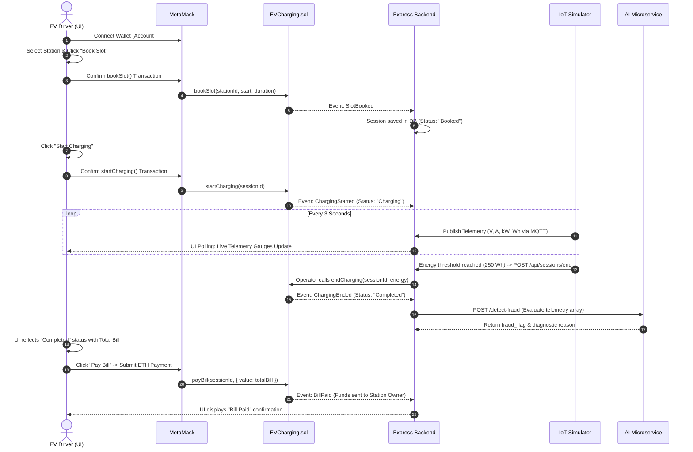

# VoltNet Web3 Frontend: Architecture & System Summary

**Application:** VoltNet Smart EV Charging Network  
**Technology Stack:** React 19, Vite, Ethers.js v6, Lucide Icons, Vanilla CSS (Glassmorphism & Responsive Design)  
**Target URL:** `http://localhost:5173`  
**Smart Contract:** [`EVCharging.sol`](file:///d:/ev%20charging/hardhat/contracts/EVCharging.sol) deployed at `0x5FbDB2315678afecb367f032d93F642f64180aa3`

---

## 1. Executive Overview

The **VoltNet Frontend** is a decentralized Web3 single-page dashboard designed for smart electric vehicle (EV) charging stations within a microgrid campus environment (modeled after VIT Vellore). 

It bridges three core systems into a unified glassmorphic interface:
1. **Ethereum Smart Contract Layer:** Atomic slot booking, on-chain time-of-use (ToU) billing, and peer-to-peer escrow payment settlements.
2. **IoT Telemetry Streaming:** Live rendering of electrical parameters (Amperes, Volts, Kilowatts, and cumulative Watt-hours) received over Mosquitto MQTT.
3. **AI Predictive Microservices:** Real-time occupancy forecasting (Scikit-Learn linear regression) and EV battery state-of-health (SOH%) impedance tracking.

---

## 2. Role-Based Access Control (RBAC)

The frontend automatically identifies the user's role upon connecting MetaMask and renders role-specific interfaces:

```
                  +-------------------------------+
                  | MetaMask Account Connected   |
                  +---------------+---------------+
                                  |
               +------------------+------------------+
               |                                     |
               v                                     v
       [ Contract / Station Owner ]           [ Regular EV Driver ]
         (Account #0: 0xf39Fd6...)              (Account #1: 0x70997...)
               |                                     |
      +--------v---------+                  +--------v---------+
      |  🛡️ Station Admin |                  |   🚗 EV Driver   |
      +--------+---------+                  +--------+---------+
               |                                     |
       - Dual View Switcher                  - Clean Station Cards
       - Admin Pricing Console               - Slot Booking Modal
       - Demand & Solar Sliders              - Live Telemetry Gauges
       - Direct On-Chain Updates             - ETH Bill Settlement
```

### A. Station Admin / Grid Operator Mode
* **Account:** Hardhat Account #0 (`0xf39Fd6e51aad88F6F4ce6aB8827279cffFb92266`)
* **Visual Indicator:** Amber/gold glassmorphic badge `🛡️ STATION ADMIN`.
* **View Switcher:** Unlocks navigation tabs to toggle between **Driver Booking View** and **Admin Pricing Console**.
* **Admin Pricing Console:**
  * Displays dedicated management cards for all 8 campus stations.
  * **Demand Markup Slider:** Adjusts grid congestion markup from `0%` to `200%`.
  * **Solar/Renewable Ratio Slider:** Adjusts green energy discount factor from `0%` to `100%`.
  * **Apply to Chain:** Submits on-chain transactions invoking `updateStationPricing(stationId, demand, renewable)` directly via the connected signer.

### B. EV Driver Mode
* **Account:** Hardhat Account #1 (`0x70997970C51812dc3A010C7d01b50e0d17dc79C8`) or any external wallet.
* **Visual Indicator:** Emerald glassmorphic badge `🚗 EV DRIVER`.
* **Interface Experience:** Clean, driver-focused interface with **zero pricing configuration clutter**.
* **Features Available:** Slot reservation, dynamic tariff inspection, live charging progress gauges, and invoice settlement.

---

## 3. Key Components & Visual Architecture

### 3.1 Header Navigation & Web3 Bar
* **Logo & Title:** Animated glowing lightning icon (`Zap`) with dynamic CSS gradient branding.
* **Role Badge:** Displays `🛡️ Station Admin` or `🚗 EV Driver`.
* **MetaMask Controls:**
  * Displays truncated wallet address (e.g., `0xf39F...2266`).
  * **Switch Account:** Invokes `wallet_requestPermissions` to switch MetaMask accounts seamlessly without disconnecting.
  * **Disconnect:** Resets application provider and contract states.
* **Network Status Badge:**
  * Green indicator `Localhost (1337)` when connected to the local node.
  * One-click button **`⚠️ Switch to Localhost 8545`** that automatically calls `wallet_switchEthereumChain` / `wallet_addEthereumChain` if connected to the wrong network (e.g., Mainnet or Sepolia).

### 3.2 Charging Stations Grid (Left Panel)
* Displays campus station cards with real-time metadata:
  * **Base Rate:** Formatted in ETH/Wh (derived from on-chain Wei).
  * **Demand Surcharge Pill:** Highlights active peak-demand markups (e.g., `+40%`).
  * **Solar Energy Pill:** Green badge highlighting renewable ratio (e.g., `Solar: 90%`).
  * **Dynamic Wait Time Estimator:** Calculated dynamically from active session duration and queue lengths.
  * **Live AI Demand Forecast:** Shows predicted occupancy ratio and real-time advice (e.g., *"Moderate Congestion Expected"* or *"Critical Demand Surcharge Active"*).
  * **Queue Section:** Displays upcoming booked slots and driver addresses.
  * **Book Slot Button:** Opens the booking modal.

### 3.3 Slot Booking Dialogue Modal
* Triggered by clicking **Book Slot** on any active station.
* **Date & Time Picker:** Selects desired charging window.
* **Duration Selector:** Sets requested charging time in minutes.
* **Dynamic Price Estimator:** Calls `calculateRatePerWh(stationId, timestamp)` on the smart contract in real time, factoring in Time-of-Use (ToU) peak hours, demand markups, and solar discounts to preview estimated cost before submitting.
* Submits on-chain transaction: `evContract.bookSlot(stationId, startTimeUnix, durationSeconds)`.

### 3.4 Driver Sessions & Billing Center (Right Panel)
* **AI Battery Health Profile Widget:**
  * Analyzes historical charging speed fade ($Wh/\text{minute}$) across multiple sessions.
  * Displays battery State-of-Health (SOH%), status rating, and diagnostic care advice.
* **Session Cards:**
  * **Session Header:** Session ID and lifecycle status badge (`Booked`, `Charging`, `Completed`, `Paid`, `Cancelled`).
  * **Station & Duration:** Campus location and reserved duration.
  * **AI Fraud Alert Banner:** Displayed if the AI microservice flagged anomalies during charging (e.g., non-monotonic energy decrease or over-current).
  * **Live Telemetry Dashboard:**
    * Appears when session status is `Charging`.
    * Streams live metrics updated via backend polling:
      * **Current:** Real-time amperage (e.g., `32.1 A`).
      * **Voltage:** Grid voltage (e.g., `230 V`).
      * **Power:** Active power output in kilowatts (e.g., `7.38 kW`).
      * **Cumulative Energy:** Energy delivered in Watt-hours with visual progress bar.
  * **Action Buttons:**
    * `Start Charging`: Available when status is `Booked`. Initiates on-chain `startCharging(sessionId)`.
    * `Pay Bill`: Available when status is `Completed`. Initiates on-chain `payBill(sessionId)` with exact Wei total.

---

## 4. End-to-End Session Lifecycle on the UI



---

## 5. Technical Data Flow & Backend Endpoints

| UI Component | Backend API Route | Protocol / Service | Purpose |
| :--- | :--- | :--- | :--- |
| Station Cards | `GET /api/stations` | REST / MongoDB | Station list, coordinates, base price, dynamic factors. |
| AI Forecast Badge | `GET /api/ai/forecast/:stationId` | REST $\rightarrow$ FastAPI `:8000` | Machine learning predicted occupancy ratio and advice. |
| Battery Health Widget | `GET /api/ai/battery-health/:user` | REST $\rightarrow$ FastAPI `:8000` | EV battery SOH% degradation analysis. |
| Sessions History | `GET /api/sessions/user/:user` | REST / MongoDB | User active and historical session records. |
| Live Telemetry Feed | `GET /api/sessions/active/:id` | REST / MQTT Cache | Real-time voltage, amperage, power, and energy. |
| Session End / Settlement | `POST /api/sessions/end` | REST $\rightarrow$ Hardhat RPC | Submits operator bill transaction upon threshold. |

---

## 6. Accounts Matrix for Verification & Demo

The application is pre-configured to work with the default Hardhat node mnemonic:

| Role | Account Index | Public Address | Private Key | Responsibilities in UI |
| :--- | :--- | :--- | :--- | :--- |
| **Admin / Owner** | Account #0 | `0xf39Fd6e51aad88F6F4ce6aB8827279cffFb92266` | `0xac0974bec39a17e36ba4a6b4d238ff944bacb478cbed5efcae784d7bf4f2ff80` | Accesses **Admin Pricing Console**, modifies demand & solar sliders, collects station payouts. |
| **EV Driver** | Account #1 | `0x70997970C51812dc3A010C7d01b50e0d17dc79C8` | `0x59c6995e998f97a5a0044966f0945389dc9e86dae88c7a8412f4603b6b78690d` | Books charging slots, starts sessions, monitors live telemetry, pays bills. |
| **EV Driver 2** | Account #2 | `0x3C44CdDdB6a900fa2b585dd299e03d12FA4293BC` | `0x5de4111afa1a4b94908f83103eb1f1706367c2e68ca870fc3fb9a804cdab365a` | Simulates multi-user slot contention and double-booking prevention. |

---

## 7. How to Run & Build

```powershell
# Run the local frontend dev server
cd "d:\ev charging\frontend"
npm run dev
# Dashboard accessible at http://localhost:5173

# Validate production bundle correctness
npm run build
```
